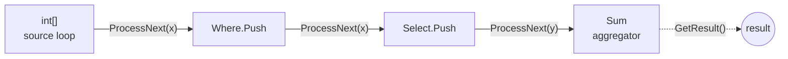
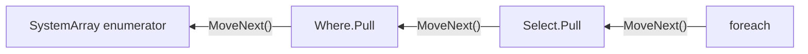
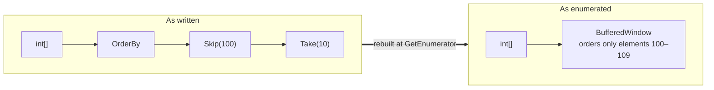

# Cistern.ValueLinq

LINQ to Objects rebuilt from value types. Switching to it means changing one `using`.

The architecture was designed in [2020](docs/history.md). It has now been filled in, with the assistance of Claude, to
cover the whole `System.Linq` surface. Improvements to the JIT since then let it run [faster](#benchmarks) than
`System.Linq` and ZLinq on most of the queries measured. Its architecture, value types throughout, still lets a chain
be optimised at run time: nodes rewrite each other, and a typed chain is recreated where a different chain pays.

The design pays in full only where the element types are value types. For a reference type the JIT compiles one
shared implementation over the canonical type (`__Canon`) and looks up the exact types at run time. Calls through
shared code are inlined far less often, and inlining is what the performance here rests on. Sharing gains little in
return, since each chain is a type of its own and two chains rarely share an instantiation. A future JIT might allow
unshared code to be requested for chosen types, or let PGO specialise shared code where it runs hot. Neither exists yet.

Nearly all of the corefx `System.Linq` test suite runs and passes against it ([skipped tests](#skipped-tests)). That includes `System.Linq`'s
inconsistencies: whether a selector is run for its side effects or treated as free of them varies from operator to
operator, and Cistern follows each case.

At the least it is a curiosity. It should also serve the JIT team as a demanding benchmark of generic specialisation
over value types.

```csharp
using Cistern.ValueLinq;   // in place of using System.Linq;
```

That `using` is the whole migration. The operators keep their names, signatures and results. What changes is the type
each query is built from. Is this wise? Probably not: it should probably be opt-in, through a function. But this is an
exercise in what _can_ be done, not necessarily in what should be.

[History](docs/history.md) · [Architecture](docs/architecture.md) · [Source generators](docs/generators.md) ·
[Benchmarks](#benchmarks)

---

## What it is

Every operator is a generic struct that wraps the struct of the operator before it. A query such as

```csharp
array.Where(x => x > 0).Select(x => x * 2).Sum()
```

is, before `Sum` runs, a single value of the type

```
Select.Node<int, int, Where.Node<int, SystemArray.Node<int>>>
```

The JIT compiles a specialisation of each method for each struct instantiation. The whole chain is therefore known
when the loop is compiled: the calls between operators are direct, and the inliner can collapse them into one loop.
Generics do the work that a hand-written loop does by knowing the source type.

## Properties

- **Compatibility.** The `System.Linq` test suite from dotnet/runtime is imported in full (`Tests/`) and runs against
  Cistern. Behaviour follows `System.Linq` where it is observable, including where that behaviour is not uniform:
  - `Count()` over a `Select` runs the selector once per element, as `System.Linq` does, even though no other
    aggregate runs a selector it does not need.
  - A `List<T>` is read as a span where `System.Linq` reads it as a span. It is enumerated, and throws when modified
    mid-enumeration, where `System.Linq` enumerates it.
  - Selectors run for the elements `System.Linq` runs them for: not for elements a `Skip` passes over in a sliceable
    source, and not for elements other than the one `First`, `Last` or `ElementAt` returns.

  A test skipped for Cistern carries a `CISTERN.VALUELINQ` reason. The skips are summarised under [Skipped tests](#skipped-tests).
- **Allocation.** A chain is a value on the stack. An aggregation over an array, a `List<T>`, a span or a `Range`
  allocates nothing beyond its result. Working buffers that do not outlive the call (the `ToArray` and `ToList` builders,
  a collection copied out to be read as a span, what Reverse, Shuffle and OrderBy buffer for a push) are rented from
  the shared pool. So is what they buffer for a `foreach`, held through one small object shared by every copy of the
  enumerator, so the buffer goes back to the pool once
  ([Copies and rented buffers](ValueLinq/Docs/PullProtocol.md#copies-and-rented-buffers)).
- **Two execution models, both typed.** Aggregations push. `foreach` pulls. Each is compiled from the same nodes, and
  neither erases the chain's type.
- **Cross-operator optimisation.** Nodes answer requests from the nodes above them (`Count`, `CopyTo`, `SkipTake`,
  `ElementAt`, …), so `Skip(n)` over a `List<T>` becomes a slice, `Select(f).First()` runs `f` once, and a
  `Concat` of collections copies each part straight into the result.
- **`IEnumerable<T>` boundaries.** A Cistern chain handed out as `IEnumerable<T>` and consumed by another Cistern
  chain is recognised. It is pulled or pushed through its own compiled chain rather than through `IEnumerator<T>` per
  element. `ToEnumerable()` hands a chain out as an `ICollection<T>` where its length is known without enumerating, so
  a consumer such as `new List<T>(e)` sizes its storage exactly and fills it with one `CopyTo`.

## Push and pull

### Push

An aggregation (`Sum`, `ToList`, `First`, `Max`, …) builds a chain of forwarder structs ending in the aggregator,
then hands it to the source. The source runs its own loop, so an array, a list and a `HashSet<T>` each get the loop
best suited to them. A source with contiguous storage hands its span to the chain whole, and the aggregator can then
run a vectorised loop.



### Pull

`foreach` pulls. Each operator has a struct enumerator, and `ValueEnumerable<TSource, TNode, TEnumerator>` carries the
whole enumerator chain's type, so `GetEnumerator` returns the complete chain by value. `MoveNext` is a direct call into
it. No interface dispatch is involved.



### Overriding the static type where it pays

A statically typed pull chain cannot change type at run time, but some queries are much cheaper in a different chain.
`OrderBy(k).Skip(100).Take(10)` only needs the ten elements of the window, not the whole sort. On the pull side,
`Skip` and `Take` ask the ordering below them whether it can absorb them. The ordering answers by building a
*buffered window* node, which puts only the window's elements in order. `foreach` is then handed this rebuilt chain in place of
the typed one.



The push side does the same through its `SkipTake` request.

## Benchmarks

The full results are in two reports. Click through to see every entry, with links to each entry's source:

- **[Parity suite](https://manofstick.github.io/Cistern.ValueLinq/Benchmark/Reports/Results/parity-report.html)**: 379 entries, from an audit of `System.Linq`'s source, one entry per
  special case it handles (a source type, an operator pairing, an early exit). Each is written for Cistern,
  `System.Linq`, ZLinq and a hand-coded loop, and every version's result is checked against `System.Linq`'s. Run with
  BenchmarkDotNet `--job short`.
- **[Toub suite](https://manofstick.github.io/Cistern.ValueLinq/Benchmark/Reports/Results/toub-report.html)**: 103 entries, the LINQ benchmarks from Stephen Toub's performance posts for
  each release from .NET Core 2.0 to .NET 11, at the posts' sizes and data, checked in the same way. Run with
  `--job short --iterationCount 20 --warmupCount 5`.

Both ran on .NET 11 RC2, one process per case, and were written up by
[`Benchmark/Reports/Report.cs`](Benchmark/Reports/README.md).

The tables below are entries of the Parity suite, over sources of 10,000 elements, rerun on .NET 11 RC3 on a 12th Gen
Intel Core i5-1240P under Linux, with two launches of 10 warmup and 20 measured iterations each. The reports and the
counts drawn from the whole suite are from the earlier RC2 run on other hardware. The multiple after each System.Linq
and ZLinq time is that library's time divided by Cistern's. Below each time is the memory the call allocated.

| Query | Cistern | System.Linq | ZLinq |
|---|--:|--:|--:|
| [`object[]`<br>`.OfType<string>()`<br>`.Select(s => s.Length)`<br>`.Sum()`](https://github.com/manofstick/Cistern.ValueLinq/blob/main/Benchmark/Parity/A/Benchmark.CisternValueLinq.cs#L38-L42) | **18.3 µs**<br><br>0 B | 67.6 µs (3.7×)<br><br>104 B | 20.7 µs (1.1×)<br><br>0 B
| [`List<int>`<br>`.Skip(n/4)`<br>`.Take(n/2)`<br>`.Select(f)`<br>`.Sum()`](https://github.com/manofstick/Cistern.ValueLinq/blob/main/Benchmark/Parity/A/Benchmark.CisternValueLinq.cs#L66-L71) | **1.41 µs**<br><br>0 B | 8.43 µs (6.0×)<br><br>152 B | 5.40 µs (3.8×)<br><br>0 B
| [`List<int>`<br>`.Concat(List<int>)`<br>`… ×7`<br>`.Sum()`](https://github.com/manofstick/Cistern.ValueLinq/blob/main/Benchmark/Parity/A/Benchmark.CisternValueLinq.cs#L140-L149) | **0.72 µs**<br><br>32 B | 17.4 µs (24×)<br><br>760 B | 12.6 µs (18×)<br><br>0 B
| [`int[]`<br>`.Append(…) ×4`<br>`.Prepend(…) ×4`<br>`.Sum()`](https://github.com/manofstick/Cistern.ValueLinq/blob/main/Benchmark/Parity/A/Benchmark.CisternValueLinq.cs#L152-L162) | **1.02 µs**<br><br>1,008 B | 19.5 µs (19×)<br><br>976 B | 20.5 µs (20×)<br><br>0 B
| [`IEnumerable<int>`<br>`.TakeLast(10)`<br>`.ToArray()`](https://github.com/manofstick/Cistern.ValueLinq/blob/main/Benchmark/Parity/E/Benchmark.CisternValueLinq.cs#L96-L99) | **14.7 µs**<br><br>224 B | 33.4 µs (2.3×)<br><br>376 B | 41.8 µs (2.8×)<br><br>104 B
| [`iterator`<br>`.Concat(Collection<int>)`<br>`.Concat(Collection<int>)`<br>`.ToArray()`](https://github.com/manofstick/Cistern.ValueLinq/blob/main/Benchmark/Parity/F/Benchmark.CisternValueLinq.cs#L48-L52) | **3.71 µs**<br><br>78.9 KB | 32.0 µs (8.6×)<br><br>78.4 KB | 41.7 µs (11×)<br><br>78.2 KB
| [`int[]`<br>`.OrderBy(k)`<br>`.Select(f)`<br>`.First()`](https://github.com/manofstick/Cistern.ValueLinq/blob/main/Benchmark/Parity/A/Benchmark.CisternValueLinq.cs#L45-L49) | **5.86 µs**<br><br>0 B | 11.0 µs (1.9×)<br><br>144 B | 826 µs (141×)<br><br>128 B
| [`int[]`<br>`.OrderBy(k)`<br>`.Skip(100)`<br>`.Take(10)`<br>`.ToArray()`](https://github.com/manofstick/Cistern.ValueLinq/blob/main/Benchmark/Parity/A/Benchmark.CisternValueLinq.cs#L118-L123) | **81.3 µs**<br><br>200 B | 114 µs (1.4×)<br><br>120,408 B | 97.4 µs (1.2×)<br><br>224 B
| [`foreach over int[]`<br>`.OrderBy(k)`<br>`.Skip(100)`<br>`.Take(100)`](https://github.com/manofstick/Cistern.ValueLinq/blob/main/Benchmark/Parity/B5/Benchmark.CisternValueLinq.cs#L96-L102) | **19.6 µs**<br><br>536 B | 25.8 µs (1.3×)<br><br>120,344 B | 25.1 µs (1.3×)<br><br>160 B

The largest gaps are differences of algorithm rather than of constant factor: the slower library does work that the
answer does not need.

| Query | Cistern | System.Linq | ZLinq | |
|---|--:|--:|--:|---|
| [`double[]`<br>`.Min()`](https://github.com/manofstick/Cistern.ValueLinq/blob/main/Benchmark/Parity/E/Benchmark.CisternValueLinq.cs#L11-L13) | **3.9 ns**<br><br>0 B | 13,008 ns (3,348×)<br><br>0 B | 12,243 ns (3,151×)<br><br>0 B | A `NaN` at index 10. Cistern returns on reaching it. |
| [`List<int>`<br>`.Append(1)`<br>`.Skip(100)`<br>`.Take(n/2)`<br>`.Last()`](https://github.com/manofstick/Cistern.ValueLinq/blob/main/Benchmark/Parity/B3/Benchmark.CisternValueLinq.cs#L64-L69) | 5.6 ns<br><br>0 B | 9,115 ns (1,622×)<br><br>208 B | **5.5 ns** (0.97×)<br><br>0 B | Cistern and ZLinq index the last element. System.Linq enumerates. |
| [`int[]`<br>`.OrderBy(k)`<br>`.Contains(x)`](https://github.com/manofstick/Cistern.ValueLinq/blob/main/Benchmark/Parity/B5/Benchmark.CisternValueLinq.cs#L210-L213) | **67.4 ns**<br><br>0 B | 79.7 ns (1.2×)<br><br>88 B | 802,571 ns (11,913×)<br><br>128 B | Cistern and System.Linq search the source without sorting it. ZLinq sorts. |

The two tables show where Cistern is clearly ahead, and not every result is like this. Across all 379 Parity entries:

| Cistern against | ahead (≤ 0.9×) | level | behind 1.1–2× | behind ≥ 2× |
|---|--:|--:|--:|--:|
| System.Linq | 194 | 121 | 46 | 18 |
| ZLinq | 223 | 79 | 53 | 18 |

### Where Cistern is behind

The weak point is the very small query: an answer that takes constant time (`Count`, `First`, `ElementAt` and the
like), or one over an empty source. Of the 126 Parity entries that Cistern runs in under 100 ns, System.Linq or ZLinq
is faster on nearly half (58). Cistern recovers the source's type and builds its chain before answering, which costs
a few nanoseconds that System.Linq's single type test, or ZLinq's constant-folded answer, does not.

| Query | Cistern | System.Linq | ZLinq |
|---|--:|--:|--:|
| [`IEnumerable<int> (a HashSet<int>)`<br>`.Count()`](https://github.com/manofstick/Cistern.ValueLinq/blob/main/Benchmark/Parity/C/Benchmark.CisternValueLinq.cs#L10-L12) | 3.0 ns<br><br>0 B | **1.4 ns** (0.48×)<br><br>0 B | 3.1 ns (1.1×)<br><br>0 B
| [`List<int>`<br>`.Concat(List<int>)`<br>`.Count()`](https://github.com/manofstick/Cistern.ValueLinq/blob/main/Benchmark/Parity/B6/Benchmark.CisternValueLinq.cs#L41-L44) | 8.9 ns<br><br>0 B | 12.0 ns (1.3×)<br><br>56 B | **1.7 ns** (0.20×)<br><br>0 B

At microsecond scale the differences are smaller, apart from `Shuffle`, where the method differs:

| Query | Cistern | System.Linq | ZLinq | |
|---|--:|--:|--:|---|
| [`int[]`<br>`.ToLookup(k)`<br>`.Count`](https://github.com/manofstick/Cistern.ValueLinq/blob/main/Benchmark/Parity/B11/Benchmark.CisternValueLinq.cs#L142-L145) | 61.9 µs<br><br>113.7 KB | 59.4 µs (0.96×)<br><br>127.1 KB | **45.0 µs** (0.73×)<br><br>126.3 KB | |
| [`iterator`<br>`.Reverse()`<br>`.ToArray()`](https://github.com/manofstick/Cistern.ValueLinq/blob/main/Benchmark/Parity/B8/Benchmark.CisternValueLinq.cs#L86-L89) | 14.8 µs<br><br>39.1 KB | **11.6 µs** (0.78×)<br><br>39.2 KB | 23.7 µs (1.6×)<br><br>39.2 KB | |
| [`List<int>`<br>`.Where(f)`<br>`.ToArray()`](https://github.com/manofstick/Cistern.ValueLinq/blob/main/Benchmark/Parity/D/Benchmark.CisternValueLinq.cs#L216-L219) | 26.5 µs<br><br>19.5 KB | **21.8 µs** (0.82×)<br><br>19.6 KB | 25.1 µs (0.95×)<br><br>19.5 KB | |
| [`int[]`<br>`.Shuffle()`<br>`.ToArray()`](https://github.com/manofstick/Cistern.ValueLinq/blob/main/Benchmark/Parity/B9/Benchmark.CisternValueLinq.cs#L91-L94) | 27.8 µs<br><br>39.1 KB | 28.2 µs (1.0×)<br><br>39.1 KB | **15.3 µs** (0.55×)<br><br>39.1 KB | ZLinq has its own generator and a batched Fisher–Yates ([dotnet/runtime#111015](https://github.com/dotnet/runtime/pull/111015), unbiased, not adopted by .NET). System.Linq and Cistern use `Random.Shared`. |

The full results are kept as HTML in [`Benchmark/Reports/Results/`](Benchmark/Reports/Results) and published
through the links above. [`Benchmark/Reports/`](Benchmark/Reports/README.md) describes how to reproduce them. The Toub suite
(`Benchmark/Toub/`) imports the LINQ benchmarks from each .NET release's performance post since .NET Core 2.0, at
the post's sizes.

### The test suite as a workload

The imported corefx suite (52,238 test cases) also builds against `System.Linq`, its files falling back to
`using System.Linq;` without `CISTERN_VALUELINQ`, so it gives a broad workload of small queries over every operator.
Each build was run in a process of its own that loaded the test assembly once and ran the whole suite three times
through xUnit's in-process runner, single-threaded, on .NET 11.0.0 on the same i5-1240P. Every pass of both builds
passed the same cases and skipped the same 103. Two runs, the second with the order of the builds swapped:

| Pass | Cistern | System.Linq |
|---|--:|--:|
| 1 (cold) | 23.1 s, 23.2 s | 21.5 s, 21.1 s |
| 2 | 15.0 s, 15.0 s | 17.1 s, 15.6 s |
| 3 | 14.8 s, 14.6 s | 16.3 s, 15.6 s |

The first pass carries the JIT: about 8.5 s of it for Cistern against about 5.5 s for `System.Linq`, as each chain
the suite builds is a type of its own and compiled separately, where `System.Linq`'s operators are shared code. Once
compiled, Cistern runs the suite 5–10% faster, and most likely while still running mostly tier-0 code: a method is
recompiled at tier 1, with Dynamic PGO, only once it has been called 30 times, and most of the chains the suite builds
are each run only a few times, even over three passes. Tier 0 neither optimises nor inlines, and inlining is what
Cistern's chains rest on, while `System.Linq`'s operators start from the framework's precompiled (ReadyToRun) code.
Much of each pass is xUnit, the assertions and the theory data, the same in both builds, so the share of the
difference that is LINQ's is larger than these totals show.

## A .NET 11 bug worked around

`MemoryExtensions.Sort(keys, items, comparer)`, the overload sorting a second span alongside the first, mis-orders
more than 16 elements when the comparer is a struct
([dotnet/runtime#136274](https://github.com/dotnet/runtime/issues/136274)). The fix,
[dotnet/runtime#136333](https://github.com/dotnet/runtime/pull/136333), is not in the 11.0 release, which still
mis-orders. `OrderBy` and its relatives therefore sort the index map alone and read the elements through it, rather
than sorting the elements alongside it.

## Further reading

- [History](docs/history.md): from F#'s `Seq` through Cistern.Linq to value types.
- [Architecture](docs/architecture.md): nodes, the push and pull chains, requests, and the role of the JIT.
- [Source generators](docs/generators.md): the attributes and what they write.
- [`ValueLinq/Docs/PullProtocol.md`](ValueLinq/Docs/PullProtocol.md) and
  [`ValueLinq/Docs/BatchFromLocalCopy.md`](ValueLinq/Docs/BatchFromLocalCopy.md): two contracts in detail.

## Skipped tests

Of 52,238 test cases in the imported suite, 52,135 pass, none fail, and 103 are skipped.[^tests]
Apart from nine edge cases of behaviour, the skips test type identity, an API not in .NET 11, or areas outside
Cistern's scope.

| Reason | Skipped |
|---|--:|
| Type identity: a result that cannot be cast to an `IEnumerator<T>`, is not an `IOrderedEnumerable<T>`, `IList<T>` or `Lookup`, or is not the same instance as its source or a shared singleton | 69 |
| Behaviour not reproduced: when `GetEnumerator` reaches the source, `ElementAt`'s exception type over an `IList<T>`, how far `Last` over a `Reverse` enumerates, and similar | 9 |
| Debugger display (`EnumerableDebugView`), not yet done | 6 |
| `Array.CreateFilled`, not in .NET 11 | 4 |
| Fails against `System.Linq` on .NET 11 as well | 3 |
| `System.Linq.Queryable`, which is out of scope | 2 |
| Upstream conditions not met in an ordinary run (stress mode, debugger proxy support, and the like) | 10 |

[^tests]: Counted from `dotnet test Tests/Linqs.Tests.csproj -c Release` on .NET 11.0.0, in which each row of a
    theory is a test case; the suite has 1,889 test methods. The first six rows are the 93 tests skipped with a
    `CISTERN.VALUELINQ` reason, the last row upstream's own conditional skips. Separately, 61 passages of test code that
    cannot compile against Cistern's types are excluded under `#if !CISTERN_VALUELINQ`, 55 compile against a
    different static type under `#if CISTERN_VALUELINQ`, and the 4 using `Array.CreateFilled` are under
    `#if NET12_0_OR_GREATER`.

## Licence

MIT. Portions derived from dotnet/runtime, and `ValueLinq/Utils/InsertionMap.cs` from Cysharp's ZLinq
(`DictionarySlim`), both MIT; see [THIRD-PARTY-NOTICES.TXT](THIRD-PARTY-NOTICES.TXT).
