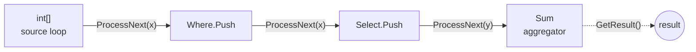
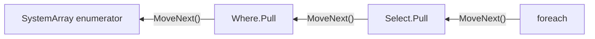
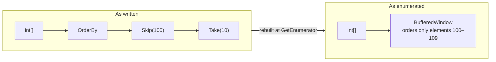

# Cistern.ValueLinq

LINQ to Objects, rebuilt out of structs. Change one `using` and your existing queries compile against it untouched:

<pre>
using <del>System.Linq</del> Cistern.ValueLinq;
</pre>

It is on NuGet as [Cistern.ValueLinq](https://www.nuget.org/packages/Cistern.ValueLinq), a preview for now, and needs
.NET 11:

```
dotnet add package Cistern.ValueLinq --prerelease
```

The operators keep their names, signatures and results. What changes is the type a query is made of: every operator is
a generic struct wrapping the one before it, so the JIT sees the whole query as a single type and can inline it into
one loop. On .NET 11 that is enough to run [faster](#benchmarks) than both `System.Linq` and
[ZLinq](https://github.com/Cysharp/ZLinq) on most of the queries measured.

The architecture dates from [2020](docs/history.md), when it covered a corner of LINQ. Since then the JIT has got a
good deal better at this kind of code, and with Claude's help the design has been filled in to cover the whole
`System.Linq` surface. Being structs all the way down hasn't cost it the ability to adapt at run time, either: nodes
rewrite each other, and a typed chain is rebuilt as a different one where that pays.

It is held to `System.Linq`'s own tests. The corefx suite is imported whole, and of its 52,238 cases all but
[103](docs/skipped-tests.md) run and every one that runs passes. That means matching `System.Linq`'s inconsistencies too:
whether a selector is run for its side effects or assumed to have none varies from operator to operator, and Cistern
follows each case.

Is taking over every query in a file with a `using` wise? Probably not. It should probably be opt-in, through a
function. But this is an exercise in what _can_ be done, not necessarily in what should be. There is also a real catch,
which is [reference types](#reference-types). If nothing else the library is a curiosity, and a demanding benchmark of
generic specialisation over value types that the JIT team may find a use for.

Side by side with the other two:

| | System.Linq | ZLinq | Cistern |
|---|:-:|:-:|:-:|
| Existing queries compile unchanged | ✅ | opt-in; [in part](https://github.com/Cysharp/ZLinq#difference-and-limitation) | ✅ |
| The chain itself allocates nothing | ❌ | ✅ | ✅ |
| A query is still an `IEnumerable<T>`: store it, return it, hold it across `await` or `yield` | ✅ | ❌ (a `ref struct` from .NET 9) | ✅ |
| Runs dotnet/runtime's `System.Linq` test suite | ✅ | in part | ✅ |
| Aggregations are pushed, so each source runs its own loop | ❌ | ❌ | ✅ |
| Queries directly over a `Span<T>` | ❌ | ✅ (from .NET 9) | ❌ (`ReadOnlyMemory<T>` only) |

[History](docs/history.md) · [Architecture](docs/architecture.md) · [Source generators](docs/generators.md) ·
[Benchmarks](#benchmarks)

---

## How it works

Take a query such as

```csharp
array.Where(x => x > 0).Select(x => x * 2).Sum()
```

Before `Sum` runs, that is a single value of the type

```
Select.Node<int, int, Where.Node<int, SystemArray.Node<int>>>
```

The JIT compiles a separate specialisation of a method for each struct instantiation, so by the time it compiles the
loop it knows the entire chain. The calls between operators are direct, and the inliner can collapse them into one
loop. A hand-written loop is fast because its author knew the source type; here the generics know it.

A query then runs in one of two ways, depending on who is asking. Both are compiled from the same nodes, and neither
erases the chain's type.

### Push

An aggregation (`Sum`, `ToList`, `First`, `Max`, …) builds a chain of forwarder structs ending in the aggregator and
hands it to the source. The source runs its own loop, which means an array, a list and a `HashSet<T>` each get the
loop that suits them. A source with contiguous storage hands the chain its span whole, and the aggregator is then free
to run a vectorised loop over it.



### Pull

`foreach` pulls. Each operator has a struct enumerator, and `ValueEnumerable<TSource, TNode, TEnumerator>` carries the
type of the whole enumerator chain, so `GetEnumerator` returns the complete chain by value and `MoveNext` is a direct
call into it, with no interface dispatch anywhere.



### Operators that talk to each other

Nodes answer requests from the nodes above them (`Count`, `CopyTo`, `SkipTake`, `ElementAt`, …). That is how `Skip(n)`
over a `List<T>` becomes a slice, how `Select(f).First()` runs `f` once, and how a `Concat` of collections copies each
part straight into its place in the result. A node that can't answer says so, and the query runs the general way.

### Overriding the static type where it pays

A statically typed pull chain can't change type at run time, yet some queries are far cheaper as a different chain.
`OrderBy(k).Skip(100).Take(10)` needs ten elements in order, not the whole sort. So on the pull side `Skip` and `Take`
ask the ordering below them whether it can absorb them, and the ordering answers by building a *buffered window* node
that puts only the window's elements in order. `foreach` is handed that rebuilt chain in place of the typed one.



The push side gets the same result through its `SkipTake` request.

## What else you get

### The same behaviour as System.Linq

The `System.Linq` test suite from dotnet/runtime is imported in full (`Tests/`) and runs against Cistern. Wherever
`System.Linq`'s behaviour can be observed, Cistern's matches it, including the places where that behaviour isn't
uniform:

- `Count()` over a `Select` runs the selector once per element, as `System.Linq` does, even though no other aggregate
  runs a selector it doesn't need.
- A `List<T>` is read as a span only where `System.Linq` reads it as one. Where `System.Linq` enumerates it, so does
  Cistern, and it throws when modified mid-enumeration.
- Selectors run for the elements `System.Linq` runs them for: not for elements a `Skip` passes over in a sliceable
  source, and not for elements other than the one `First`, `Last` or `ElementAt` returns.

A test skipped for Cistern carries a `CISTERN.VALUELINQ` reason, and the skips are counted up under
[Skipped tests](docs/skipped-tests.md).

### Very little garbage

A chain is a value on the stack. An aggregation over an array, a `List<T>`, a `ReadOnlyMemory<T>` or a `Range` allocates nothing
beyond its result. Working buffers that don't outlive the call are rented from the shared pool: the `ToArray` and
`ToList` builders, a collection copied out to be read as a span, and whatever Reverse, Shuffle and OrderBy buffer for
a push. What those three buffer for a `foreach` is rented as well, and held through one small object shared by every
copy of the enumerator, so the buffer goes back to the pool exactly once
([Copies and rented buffers](ValueLinq/Docs/PullProtocol.md#copies-and-rented-buffers)).

### `IEnumerable<T>` boundaries that don't forget

A Cistern chain handed out as `IEnumerable<T>` and consumed by another Cistern chain is recognised, and is pulled or
pushed through its own compiled chain rather than through `IEnumerator<T>` an element at a time. `ToEnumerable()` hands
a chain out as an `ICollection<T>` where its length is known without enumerating, so a consumer such as
`new List<T>(e)` sizes its storage exactly and fills it with one `CopyTo`.

## Beyond System.Linq

Matching `System.Linq` exactly has a cost, and a few operators exist only here to buy it back.

### `Map` and `Filter`

`System.Linq` never says whether a selector may have side effects, but its tests pin down when one runs, and Cistern
keeps to them. `Count()` over a `Select` has to call the selector for every element and throw the results away, since
somebody's selector might be counting calls. Most selectors are pure, and for those that is wasted work.

`Map` and `Filter` are `Select` and `Where` with a promise attached: the function has no side effects and its result
depends only on its argument. With that promise a `Map` answers `Count` and `Any` from its source without running
anything, projects only the one element an `ElementAt` lands on, lets a `Skip` slide beneath it, and reverses by
projecting the reversed source. A `Filter` can be scanned from the end, for a from-end index or a `Reverse`.

```csharp
list.Map(x => x * 2).Count()        // list.Count; the lambda never runs
list.Select(x => x * 2).Count()     // runs the lambda list.Count times, as System.Linq does
```

Neither is ever moved past another operator. If you want a filter below an ordering, write it there.

### `Fuse`

When one Cistern chain consumes another through an `IEnumerable<T>`, each is compiled once and the boundary between
them costs a virtual call per element. `Fuse()` removes the boundary: the two chains run as a single push, compiled
together.

It is opt-in because the price is paid in JIT time. Fused, every distinct pairing of inner and outer chain is a new
set of methods to compile, and a program that composes many chains through `IEnumerable<T>` can multiply that into
tens of thousands. Use it on the hot query, not everywhere. `ToEnumerable(EnumerableOptions.Fuse)` makes the same
choice from the other side, fusing the chain it hands out with whatever is later pushed through it.

## Reference types

The design pays in full only where the element types are value types. For a reference type the JIT compiles one
shared implementation over the canonical type (`__Canon`) and looks the exact types up at run time. Calls through
shared code are inlined far less often, and inlining is what all of the performance here rests on. Nor does sharing
buy much in return: each chain is a type of its own, so two chains rarely share an instantiation anyway.

A future JIT might let unshared code be requested for chosen types, or let PGO specialise shared code where it runs
hot. Neither exists yet.

## Benchmarks

The full results are in two reports, where every entry links to its source:

- **[Parity suite](https://manofstick.github.io/Cistern.ValueLinq/Benchmark/Reports/Results/parity-report.html)**, 379
  entries. These come from an audit of `System.Linq`'s source, one entry per special case it handles (a source type, an
  operator pairing, an early exit). Each is written for Cistern, `System.Linq`, ZLinq and a hand-coded loop, and every
  version's result is checked against `System.Linq`'s. Run with BenchmarkDotNet `--job short`.
- **[Toub suite](https://manofstick.github.io/Cistern.ValueLinq/Benchmark/Reports/Results/toub-report.html)**, 103
  entries. These are the LINQ benchmarks from Stephen Toub's performance posts for each release from .NET Core 2.0 to
  .NET 11 (`Benchmark/Toub/`), at the posts' sizes and data, and checked the same way. Run with
  `--job short --iterationCount 20 --warmupCount 5`.

Both reports are a little out of date. They ran on .NET 11 RC2, one process per case, on different hardware from the
tables below, and I haven't had the compute time to rerun them since. The HTML is kept in
[`Benchmark/Reports/Results/`](Benchmark/Reports/Results), and [`Benchmark/Reports/`](Benchmark/Reports/README.md)
describes the program that writes it and how to reproduce the runs.

The tables below are Parity entries over sources of 10,000 elements, rerun on .NET 11 RC3 on a 12th Gen Intel Core
i5-1240P under Linux, with two launches of 10 warmup and 20 measured iterations each. Any count taken across the
whole suite comes from the older reports. The multiple after each System.Linq and ZLinq time is that library's time
divided by Cistern's, and below each time is the memory the call allocated.

| Query | Cistern | System.Linq | ZLinq |
|---|--:|--:|--:|
| [`object[]`<br>`.OfType<string>()`<br>`.Select(s => s.Length)`<br>`.Sum()`](https://github.com/manofstick/Cistern.ValueLinq/blob/main/Benchmark/Parity/A/Benchmark.CisternValueLinq.cs#L38-L42) | **18.3 µs**<br><br>0 B | 67.6 µs (3.7×)<br><br>104 B | 20.7 µs (1.1×)<br><br>0 B
| [`List<int>`<br>`.Skip(n/4)`<br>`.Take(n/2)`<br>`.Select(f)`<br>`.Sum()`](https://github.com/manofstick/Cistern.ValueLinq/blob/main/Benchmark/Parity/A/Benchmark.CisternValueLinq.cs#L66-L71) | **1.41 µs**<br><br>0 B | 8.43 µs (6.0×)<br><br>152 B | 5.40 µs (3.8×)<br><br>0 B
| [`List<int>`<br>`.Concat(List<int>)`<br>`… ×7`<br>`.Sum()`](https://github.com/manofstick/Cistern.ValueLinq/blob/main/Benchmark/Parity/A/Benchmark.CisternValueLinq.cs#L140-L149) | **0.72 µs**<br><br>32 B | 17.4 µs (24×)<br><br>760 B | 12.6 µs (18×)<br><br>0 B
| [`int[]`<br>`.Append(…) ×4`<br>`.Prepend(…) ×4`<br>`.Sum()`](https://github.com/manofstick/Cistern.ValueLinq/blob/main/Benchmark/Parity/A/Benchmark.CisternValueLinq.cs#L152-L162) | **1.02 µs**<br><br>1,008 B | 19.5 µs (19×)<br><br>976 B | 20.5 µs (20×)<br><br>0 B
| [`IEnumerable<int>`<br>`.TakeLast(10)`<br>`.ToArray()`](https://github.com/manofstick/Cistern.ValueLinq/blob/main/Benchmark/Parity/E/Benchmark.CisternValueLinq.cs#L96-L99) | **14.7 µs**<br><br>224 B | 33.4 µs (2.3×)<br><br>376 B | 41.8 µs (2.8×)<br><br>104 B
| [`iterator`<br>`.Concat(Collection<int>)`<br>`.Concat(Collection<int>)`<br>`.ToArray()`](https://github.com/manofstick/Cistern.ValueLinq/blob/main/Benchmark/Parity/F/Benchmark.CisternValueLinq.cs#L48-L52) | **3.71 µs**<br><br>78.9 KB | 32.0 µs (8.6×)<br><br>78.4 KB | 41.7 µs (11×)<br><br>78.2 KB
| [`int[]`<br>`.OrderBy(k)`<br>`.Select(f)`<br>`.First()`](https://github.com/manofstick/Cistern.ValueLinq/blob/main/Benchmark/Parity/A/Benchmark.CisternValueLinq.cs#L45-L49) | **5.86 µs**<br><br>0 B | 11.0 µs (1.9×)<br><br>144 B | 826 µs (141×)<br><br>128 B
| [`int[]`<br>`.OrderBy(k)`<br>`.Skip(100)`<br>`.Take(10)`<br>`.ToArray()`](https://github.com/manofstick/Cistern.ValueLinq/blob/main/Benchmark/Parity/A/Benchmark.CisternValueLinq.cs#L118-L123) | **81.3 µs**<br><br>200 B | 114 µs (1.4×)<br><br>120,408 B | 97.4 µs (1.2×)<br><br>224 B
| [`foreach over int[]`<br>`.OrderBy(k)`<br>`.Skip(100)`<br>`.Take(100)`](https://github.com/manofstick/Cistern.ValueLinq/blob/main/Benchmark/Parity/B5/Benchmark.CisternValueLinq.cs#L96-L102) | **19.6 µs**<br><br>536 B | 25.8 µs (1.3×)<br><br>120,344 B | 25.1 µs (1.3×)<br><br>160 B

The largest gaps aren't constant factors at all. They are differences of algorithm, where the slower library does work
the answer doesn't need:

| Query | Cistern | System.Linq | ZLinq | |
|---|--:|--:|--:|---|
| [`double[]`<br>`.Min()`](https://github.com/manofstick/Cistern.ValueLinq/blob/main/Benchmark/Parity/E/Benchmark.CisternValueLinq.cs#L11-L13) | **3.9 ns**<br><br>0 B | 13,008 ns (3,348×)<br><br>0 B | 12,243 ns (3,151×)<br><br>0 B | A `NaN` at index 10. Cistern returns on reaching it. |
| [`List<int>`<br>`.Append(1)`<br>`.Skip(100)`<br>`.Take(n/2)`<br>`.Last()`](https://github.com/manofstick/Cistern.ValueLinq/blob/main/Benchmark/Parity/B3/Benchmark.CisternValueLinq.cs#L64-L69) | 5.6 ns<br><br>0 B | 9,115 ns (1,622×)<br><br>208 B | **5.5 ns** (0.97×)<br><br>0 B | Cistern and ZLinq index the last element. System.Linq enumerates. |
| [`int[]`<br>`.OrderBy(k)`<br>`.Contains(x)`](https://github.com/manofstick/Cistern.ValueLinq/blob/main/Benchmark/Parity/B5/Benchmark.CisternValueLinq.cs#L210-L213) | **67.4 ns**<br><br>0 B | 79.7 ns (1.2×)<br><br>88 B | 802,571 ns (11,913×)<br><br>128 B | Cistern and System.Linq search the source without sorting it. ZLinq sorts. |

Those two tables are the flattering ones, and not every result looks like them. Across all 379 Parity entries:

| Cistern against | ahead (≤ 0.9×) | level | behind 1.1–2× | behind ≥ 2× |
|---|--:|--:|--:|--:|
| System.Linq | 194 | 121 | 46 | 18 |
| ZLinq | 223 | 79 | 53 | 18 |

### Where Cistern is behind

The weak point is the very small query: an answer that takes constant time (`Count`, `First`, `ElementAt` and the
like), or anything over an empty source. Of the 126 Parity entries that Cistern runs in under 100 ns, System.Linq or
ZLinq is faster on nearly half (58). Cistern has to recover the source's type and build its chain before it can
answer, and that costs a few nanoseconds which System.Linq's single type test, or ZLinq's constant-folded answer,
never spends.

| Query | Cistern | System.Linq | ZLinq |
|---|--:|--:|--:|
| [`IEnumerable<int> (a HashSet<int>)`<br>`.Count()`](https://github.com/manofstick/Cistern.ValueLinq/blob/main/Benchmark/Parity/C/Benchmark.CisternValueLinq.cs#L10-L12) | 3.0 ns<br><br>0 B | **1.4 ns** (0.48×)<br><br>0 B | 3.1 ns (1.1×)<br><br>0 B
| [`List<int>`<br>`.Concat(List<int>)`<br>`.Count()`](https://github.com/manofstick/Cistern.ValueLinq/blob/main/Benchmark/Parity/B6/Benchmark.CisternValueLinq.cs#L41-L44) | 8.9 ns<br><br>0 B | 12.0 ns (1.3×)<br><br>56 B | **1.7 ns** (0.20×)<br><br>0 B

At microsecond scale the gaps are smaller, apart from `Shuffle`, where the method itself differs:

| Query | Cistern | System.Linq | ZLinq | |
|---|--:|--:|--:|---|
| [`int[]`<br>`.ToLookup(k)`<br>`.Count`](https://github.com/manofstick/Cistern.ValueLinq/blob/main/Benchmark/Parity/B11/Benchmark.CisternValueLinq.cs#L142-L145) | 61.9 µs<br><br>113.7 KB | 59.4 µs (0.96×)<br><br>127.1 KB | **45.0 µs** (0.73×)<br><br>126.3 KB | |
| [`iterator`<br>`.Reverse()`<br>`.ToArray()`](https://github.com/manofstick/Cistern.ValueLinq/blob/main/Benchmark/Parity/B8/Benchmark.CisternValueLinq.cs#L86-L89) | 14.8 µs<br><br>39.1 KB | **11.6 µs** (0.78×)<br><br>39.2 KB | 23.7 µs (1.6×)<br><br>39.2 KB | |
| [`List<int>`<br>`.Where(f)`<br>`.ToArray()`](https://github.com/manofstick/Cistern.ValueLinq/blob/main/Benchmark/Parity/D/Benchmark.CisternValueLinq.cs#L216-L219) | 26.5 µs<br><br>19.5 KB | **21.8 µs** (0.82×)<br><br>19.6 KB | 25.1 µs (0.95×)<br><br>19.5 KB | |
| [`int[]`<br>`.Shuffle()`<br>`.ToArray()`](https://github.com/manofstick/Cistern.ValueLinq/blob/main/Benchmark/Parity/B9/Benchmark.CisternValueLinq.cs#L91-L94) | 27.8 µs<br><br>39.1 KB | 28.2 µs (1.0×)<br><br>39.1 KB | **15.3 µs** (0.55×)<br><br>39.1 KB | ZLinq has its own generator and a batched Fisher–Yates ([dotnet/runtime#111015](https://github.com/dotnet/runtime/pull/111015), unbiased, not adopted by .NET). System.Linq and Cistern use `Random.Shared`. |

### The test suite as a workload

The imported corefx suite also builds against `System.Linq` (without `CISTERN_VALUELINQ` its files fall back to
`using System.Linq;`), which makes it a broad workload of small queries over every operator, and a different kind of
measurement from a benchmark loop. Each build was run in a process of its own that loaded the test assembly once and
ran the whole suite three times through xUnit's in-process runner, single-threaded, on .NET 11.0.0 on the same
i5-1240P. Every pass of both builds passed the same cases and skipped the same 103. There were two runs, the second
with the order of the builds swapped:

| Pass | Cistern | System.Linq |
|---|--:|--:|
| 1 (cold) | 23.1 s, 23.2 s | 21.5 s, 21.1 s |
| 2 | 15.0 s, 15.0 s | 17.1 s, 15.6 s |
| 3 | 14.8 s, 14.6 s | 16.3 s, 15.6 s |

The first pass carries the JIT, about 8.5 s of it for Cistern against about 5.5 s for `System.Linq`. That is the price
of every chain being a type of its own: each one the suite builds is compiled separately, where `System.Linq`'s
operators are shared code.

Once compiled, Cistern runs the suite 5–10% faster, and most likely does so on mostly tier-0 code. A method is
recompiled at tier 1, with Dynamic PGO, only after it has been called 30 times, and most of the chains the suite builds
run only a few times each, even over three passes. Tier 0 neither optimises nor inlines, which is everything Cistern's
chains depend on, while `System.Linq`'s operators start out from the framework's precompiled (ReadyToRun) code. And
much of each pass is xUnit, the assertions and the theory data, identical in both builds, so LINQ's share of the
difference is larger than these totals show.

## A .NET 11 bug worked around

`MemoryExtensions.Sort(keys, items, comparer)`, the overload that sorts a second span alongside the first, mis-orders
more than 16 elements when the comparer is a struct
([dotnet/runtime#136274](https://github.com/dotnet/runtime/issues/136274)). The fix,
[dotnet/runtime#136333](https://github.com/dotnet/runtime/pull/136333), didn't make the 11.0 release, which still
mis-orders. So `OrderBy` and its relatives sort the index map alone and read the elements through it, rather than
sorting the elements alongside.

## Further reading

- [History](docs/history.md): from F#'s `Seq` through Cistern.Linq to value types.
- [Architecture](docs/architecture.md): nodes, the push and pull chains, requests, and the role of the JIT.
- [Source generators](docs/generators.md): the attributes and what they write.
- [Skipped tests](docs/skipped-tests.md): the 103 corefx cases that don't run, and why.
- [`ValueLinq/Docs/PullProtocol.md`](ValueLinq/Docs/PullProtocol.md) and
  [`ValueLinq/Docs/BatchFromLocalCopy.md`](ValueLinq/Docs/BatchFromLocalCopy.md): two contracts in detail.

## Licence

MIT. Portions derived from dotnet/runtime, and `ValueLinq/Utils/InsertionMap.cs` from Cysharp's ZLinq
(`DictionarySlim`), both MIT; see [THIRD-PARTY-NOTICES.TXT](THIRD-PARTY-NOTICES.TXT).
