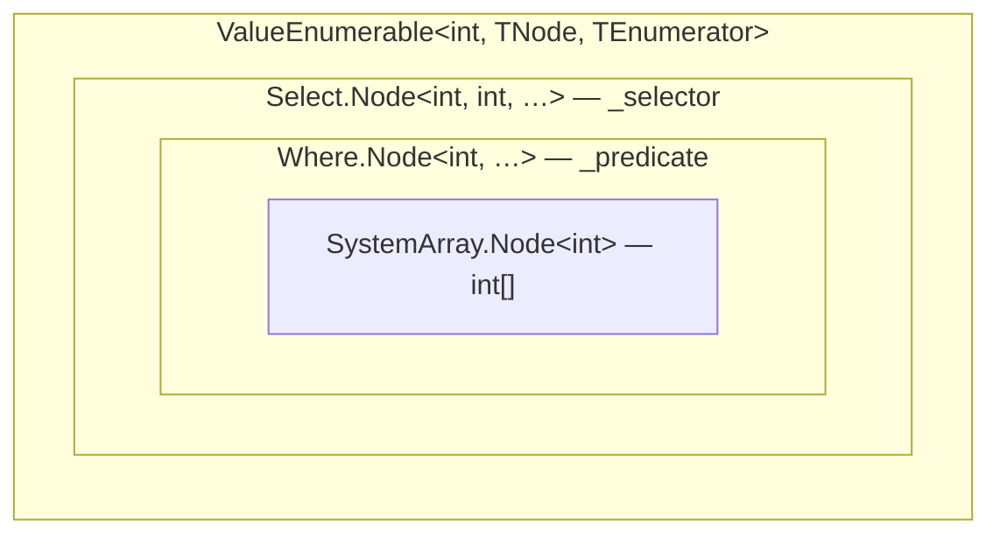
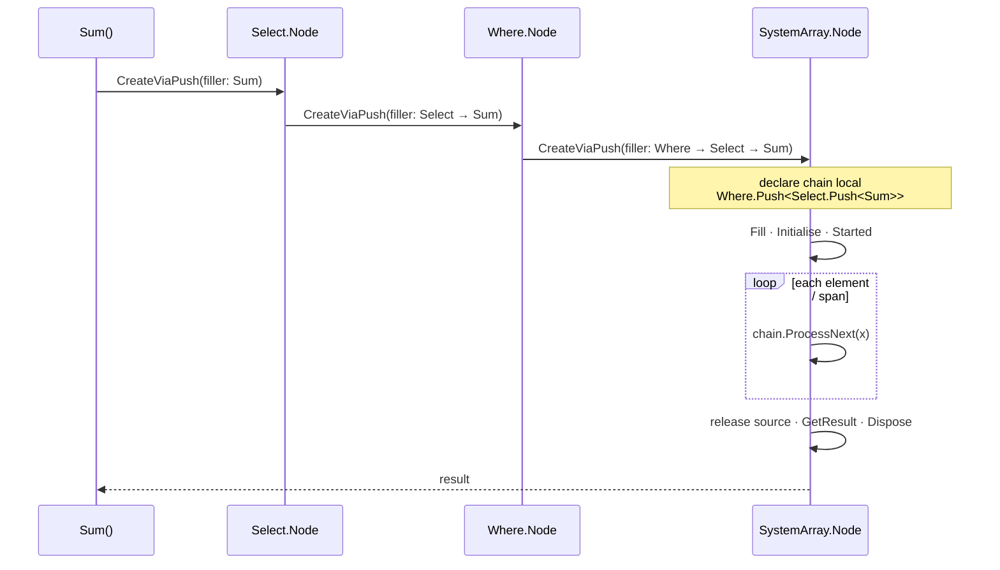
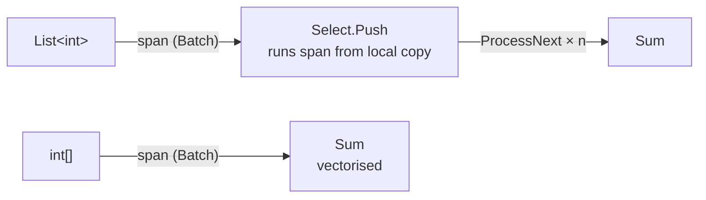
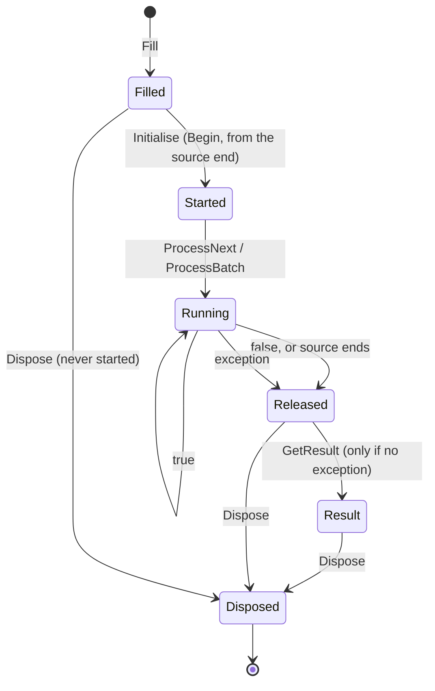
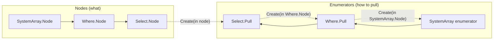
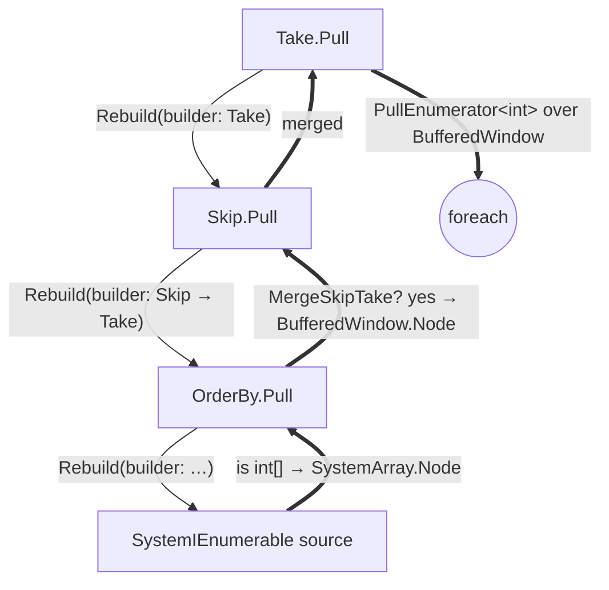
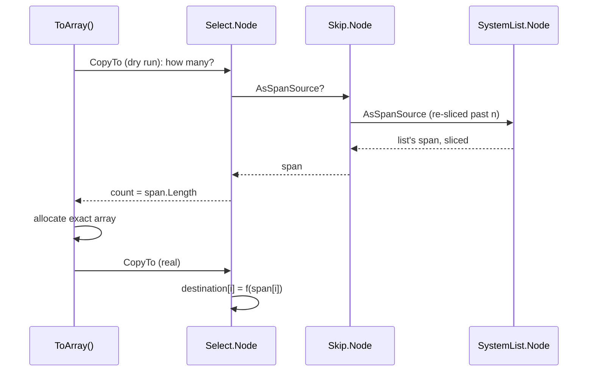
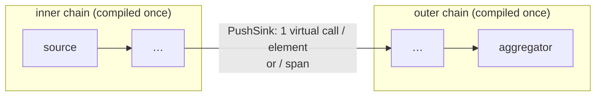
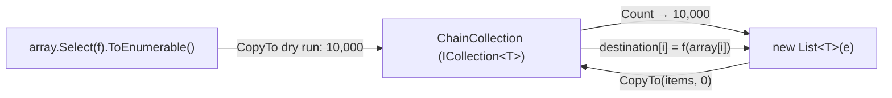

# Architecture

[← Overview](../README.md) · [History](history.md) · [Source generators](generators.md)

- [Nodes](#nodes)
- [The JIT as the optimiser](#the-jit-as-the-optimiser)
- [Push](#push)
- [Pull](#pull)
- [Requests](#requests)
- [`IEnumerable<T>` boundaries](#ienumerablet-boundaries)
- [Generated code](#generated-code)

## Nodes

Every operator is an `INode<T>` struct holding its source node and its configuration (a selector, a count, a
comparer). A query is a nesting of these structs, wrapped in `ValueEnumerable<TSource, TNode, TEnumerator>`, which
also names the type of the chain's enumerator.



Each node file under [`ValueLinq/Nodes/`](../ValueLinq/Nodes) holds one operator: its `Node`, its push forwarder
`Push`, and its pull enumerator `Pull`. Sources (arrays, lists, spans, `Range`, `IEnumerable<T>`, …) are under
[`ValueLinq/Containers/`](../ValueLinq/Containers). Aggregators are under
[`ValueLinq/Aggregation/`](../ValueLinq/Aggregation).

A query runs in one of two modes. An aggregation **pushes**: the source drives a loop and hands each element down the
chain. `foreach` **pulls**: the consumer asks the chain for each element in turn. Both run from the same nodes.

## The JIT as the optimiser

The design hands as much as possible to RyuJIT:

- **Specialisation.** A generic method instantiated over a struct is compiled separately for that struct. Every
  chain therefore gets its own code, in which each call between operators is a direct call to a known method, and so
  a candidate for inlining.
- **Constants per type.** Properties the chain asks about are `static abstract` members: `AllowBatchesWhen`
  (which batches a taker accepts), `AllowInitialise`, and `RebuildChanges` (whether a pull chain can be reshaped).
  `typeof(T) == typeof(int)` tests work the same way. In a specialised method each is a constant, and the branch it
  guards is removed.
- **Dynamic PGO.** Delegates (`Func<T, U>`) are devirtualised by guarded devirtualisation when one target dominates.
  The push loop is written inside each source and is not wrapped in exception handlers, so PGO instruments and
  optimises it as an ordinary loop. Several layout decisions exist only to keep this. For example, a `finally` is
  used rather than a `catch`, and initialisation is inline. They are recorded in the
  [project notes](../CLAUDE.md).
- **Register promotion.** A forwarder running a span copies its downstream to a local, runs the span against the
  copy and writes it back, so the aggregator's accumulator stays in a register rather than making a store-to-load
  round trip through the chain per element. See
  [`BatchFromLocalCopy.md`](../ValueLinq/Docs/BatchFromLocalCopy.md).
- **Value delegates.** Where a delegate's indirect call is the cost, a struct implementing `IFunc<T, U>` can be passed
  in its place. It is called through its constraint and inlined like the rest of the chain.

Nothing is cached between calls. Each call pays for its own decisions, so an optimisation must pay on a single call
rather than on a benchmark loop's repetition.

## Push

### Filling the chain

An aggregation is an `IPushEnumerator<T>` struct. Each operator wraps it in its forwarder struct, so the chain is a
nesting of forwarders with the aggregator innermost. It is not built on the way down. `CreateViaPush` descends the
nodes, each passing its source a *filler* (a `ref struct` holding its configuration). At the source the chain is
declared once, as a single local, and filled in place through the fillers, each forwarder writing its own fields. The
aggregator is constructed directly in its slot.



Building the aggregator elsewhere and copying it in is avoided. The copy is read back as one wide load over narrower
stores, which defeats store forwarding and measured at 6–10 ns a push.

### Batches

A source with contiguous storage hands its span to the chain whole, as a `Batch<T>`, to a taker that accepts it.
Both sides are `BatchKinds` flags tested before the batch is built, so a batch is never offered and declined. A leaf
aggregator receiving a span runs a vectorised loop where one applies (`Sum`, `Min`, `Max`, `Contains`, …).



An `ICollection<T>` is handed over *cold*, its elements not yet copied out. A `ToArray` or `ToList` builder takes it
through the collection's own `CopyTo` into its storage, and an aggregator that reads every element takes it as a span
copied into a rented buffer.

### The push protocol

Every source and every operator that pushes another sequence obeys one protocol. The test suite checks it for each
source, run to the end, stopped early and thrown out of.



- Nothing goes in after a `false`.
- The source (its enumerator, a rented buffer) is released before anything else is called on the chain.
- `GetResult` is called at most once. `Dispose` is called exactly once, last, on every path.
- Setup that runs user code (Except's set, FullJoin's lookup) is a forwarder's `Begin`, run in `Initialise`.

## Pull

### The typed chain

Each node type has one pull enumerator, an `IPullEnumerator<T>` struct that builds itself from the node and creates
its source's enumerator in turn. `ValueEnumerable` carries the enumerator chain's type, so every extension method
names it in its return type:

```csharp
ValueEnumerable<U,
    Select.Node<T, U, TPrior>,
    Select.Pull<T, U, TPrior, TPriorEnumerator>>
```

`GetEnumerator` hands `foreach` the whole chain by value, and each `MoveNext` is a direct call. The node knows nothing
of its enumerator.



Where a chain's type cannot be named (behind `IEnumerable<T>`, or over a sequence typed only at run time) it is held as
`PullEnumerator<T>`, the one heap enumerator, at one virtual call per element.

### Rebuilding

When a chain is boxed into `PullEnumerator<T>`, it is first rebuilt over what its source actually holds. An
`IEnumerable<T>` that is really an array becomes an array source, a `List<T>` a list source, and so on, so the one
virtual call is at the top of the chain rather than per element at the bottom.

`IPullEnumerator.Rebuild` walks the chain downwards. Each enumerator hands its source an `IChainBuilder`, which
rebuilds its node over whatever node and enumerator type come back up. `RebuildChanges`, a constant per chain type,
skips the walk when nothing below can change.



The walk also merges a `Skip` or `Take` into a buffering node below it (OrderBy, Reverse, Shuffle). Skip's and
Take's chain builders ask the enumerator that comes back up for `MergeSkipTake`. A buffering node answers with a
`BufferedWindow.Node`, a window whose type stays nameable, and only the window's elements are put in order.

`PreferRebuilt` is true from a `Skip` or `Take` over such an enumerator. This is the one case where `GetEnumerator`
hands `foreach` the rebuilt chain's heap enumerator rather than the typed chain, because ordering only the window
outweighs the allocation. For every other chain the allocation costs more than the rebuild saves.

The contract between an enumerator and whoever pulls it is in [`PullProtocol.md`](../ValueLinq/Docs/PullProtocol.md).

## Requests

Nodes optimise each other through requests. A request is a struct from
[`ValueLinq/Optimizations/`](../ValueLinq/Optimizations), passed down through `INode.TryPushOptimization`. A node
answers the requests it can and declines the rest, and the asker then falls back to the general path.



| Request | Asked by | Answered by, for example |
|---|---|---|
| `Count` | `Count()`, `TryGetNonEnumeratedCount` | collections, `Range`, `Skip`/`Take` over a counted source |
| `CopyTo` | `ToArray`, `ToList` | a node made of parts, each part copying into its slice |
| `SkipTake` | `Skip`, `Take` | a list or array (a slice), `Select` (the source's slice, projected) |
| `ElementAt` | `First`, `Last`, `ElementAt` | an indexable source; `Select` runs its selector on the found element only |
| `AsSpanSource` | anything that can run a span | arrays, lists, spans, memory |
| `MaterialiseArray` / `MaterialiseList` | `ToArray`, `ToList` | `Concat`, copying counted parts straight into place |
| `Contains`, `Any`, `LastMatch`, `Reverse`, … | the matching aggregates | the nodes that can answer without enumerating |

The rules that keep this safe:

- A **dry run** (`Count`, `CopyTo` without a destination) is answered only without enumerating and without running
  user code.
- A request asked for real is never declined once its dry run has been answered, and a node that declines has run
  nothing.
- `Select` declines a real `Count` and is pushed, running its selector once per element, because `System.Linq` does.

Each request is an interface marked `[Optimization]`, and a node declares the interfaces it answers. The dispatch is
generated (see [Source generators](generators.md#requests)): one guard per interface on the request's type,
calling the method directly. Each guard is a type test that folds to a constant in the specialised code.

## `IEnumerable<T>` boundaries

A Cistern chain handed out as `IEnumerable<T>` and consumed by another Cistern chain is recognised through the
internal `IPullEnumerable<T>`. Each chain is compiled once, and the boundary costs one virtual call per element:

- **pulled**, through the inner chain's own `PullEnumerator<T>`;
- **pushed**, through an `ErasedChain.PushSink<T>` holding the outer chain. A span from the inner chain's source
  crosses the boundary whole.



`Fuse()` instead compiles the outer chain through the inner chain's node, producing one fully specialised loop at the
cost of a new instantiation for every pairing.

### Handing a chain out: `ToEnumerable`

`ToEnumerable()` hands a chain out as one heap `IEnumerable<T>`. The chain is rebuilt once at the call, over whatever
its `IEnumerable<T>` sources hold, so neither its enumerators nor its pushes walk it again.

Where the chain's `CopyTo` dry run answers, meaning its length is known without enumerating, the object handed out is
a read-only `ICollection<T>` and `IReadOnlyCollection<T>`:

- `Count` is the dry run's answer, and nothing runs;
- `CopyTo(T[], int)` is the chain's `CopyTo` request, so each part writes straight into the destination (a `Select`
  over an array projects into it, a `Concat` copies each part into its slice);
- `Contains` is the chain's `Contains`.

A consumer that knows nothing of Cistern, such as `new List<T>(e)`, `List<T>.AddRange` or `System.Linq`'s `ToArray`,
sees an `ICollection<T>`. It sizes its storage exactly and fills it with one `CopyTo`,
rather than enumerating and growing.



`ToEnumerable(EnumerableOptions.Fuse)` hands the chain out as a node that is not an `IPullEnumerable<T>`, so any
Cistern chain pushing through it is fused with it.

## Generated code

The repetitive parts of every operator are written by Roslyn source generators: constructors, fillers, chain
builders, request dispatch, `Dispose`, `GetResult`, and the marker interfaces. The hand-written file carries the
algorithm (`ProcessNext`, `MoveNext`, `Current`, and the request answers), and nothing else. See
[Source generators](generators.md).
