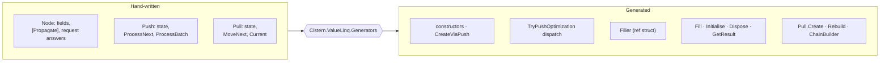

# Source generators

[← Overview](../README.md) · [History](history.md) · [Architecture](architecture.md)

A value-type operator needs a good deal of plumbing:

- constructors and a filler for the push chain;
- a chain builder for pull rebuilding;
- request dispatch;
- `Dispose` and `GetResult` passed through;
- marker interfaces read by other nodes.

All of it follows from the operator's fields and the interfaces it declares. `Cistern.ValueLinq.Generators`
(netstandard2.0, a Roslyn incremental generator) writes it from attributes on partial structs. A hand-written
operator file holds the algorithm and nothing else.

The attributes are declared in [`ValueLinq/Operator.cs`](../ValueLinq/Operator.cs). To read the generated code, build
with `-p:EmitCompilerGeneratedFiles=true`; it is written under `obj/`.



## An operator, whole

[`Select`](../ValueLinq/Nodes/Select.cs), without its request answers:

```csharp
public static partial class Select
{
    [Operator]
    public partial struct Node<T, U, NodeT>
        : INode<U>
        , Optimizations.IOptimizationCount
        , Optimizations.IOptimizationElementAt<U>
        , Optimizations.IOptimizationCopyTo<U>
        , Optimizations.IOptimizationToArray<U>
        , Optimizations.IOptimizationSkipTake<U>
        where NodeT : INode<T>
    {
        internal NodeT _nodeT;
        [Propagate] internal Func<T, U> _selector;

        // request answers: Count, ElementAt, CopyTo, ToArray, SkipTake
    }

    internal partial struct Push<T, U, Next>
    {
        public bool ProcessNext(T input) => _next.ProcessNext(_selector(input));
    }

    public partial struct Pull<T, U, NodeT, TInEnumerator>
    {
        public bool MoveNext() => _enumerator.MoveNext();
        public U Current => _selector(_enumerator.Current);
    }
}
```

The generator adds about 180 lines: the node's constructor, the request dispatch, the `_next`, `_enumerator` and
`_selector` fields of `Push` and `Pull`, `Push.Fill`, `Initialise`, `Dispose`, `GetResult`, `Pull.Create`, `Rebuild`,
the `Filler` and the `ChainBuilder`.

## Node attributes

### `[Operator]`

On the `Node` of a single-source operator written as a static partial class holding `Node`, `Push` and `Pull`.

| Written by hand | Written by the generator |
|---|---|
| Node: the source field and configuration fields | the node's constructor, `CreateViaPush` |
| Node: one method per `[Optimization]` interface declared | `TryPushOptimization` |
| Push: state fields, `ProcessNext`; `AllowBatchesWhen` and `ProcessBatch` where it runs spans | `_next`, the propagated fields, `Fill`, `Initialise`, `Dispose`, `GetResult`, the `Filler` |
| Pull: state fields, `MoveNext`, `Current` | `_enumerator`, the propagated fields, the constructor, `Create`, `Rebuild`, `Dispose`, the `ChainBuilder` |
| optional `partial void Start()` on Push or Pull: a non-default start value | its call, once the configuration is in place |

Any member the hand-written side declares displaces its generated version. A node that writes its own
`CreateViaPush` may have no `Push`. `Forwards = true` hands every request the node does not answer to its own
`Forward<TRequest, TRequestResult>` rather than declining it.

### `[Materialized]`

On the `Node` of an operator that reads its source into another node and runs as that node from then on: `Reverse`
into an array, for example.

| Written by hand | Written by the generator |
|---|---|
| Node: fields, `Materialize(in ChainOptions)` returning the node it becomes | constructor, `CreateViaPush` (materialise, then push through the result), `TryPushOptimization` |
| Node: answers to the requests it can answer without materialising | |
| Pull: one field, the materialised node's enumerator | constructor, `Create` (materialise, then enumerate), an identity `Rebuild`, the forwarding members |

### `[Answerer]`

On any other node (a container such as `SystemArray.Node` or `SystemList.Node`). The generator writes only
`TryPushOptimization`, from the `[Optimization]` interfaces declared. The dispatch is public, so a container built in
place over another's parts can be asked directly. `Forwards` as for `[Operator]`.

## Requests

### `[Optimization]` and `[PullOptimization]`

On a request's interface in [`ValueLinq/Optimizations/`](../ValueLinq/Optimizations). It must have exactly one method,
named for the request, taking the request by `in` and the result by `out`:

```csharp
[Optimization]
internal interface IOptimizationCount
{
    bool Count(in Count request, out int response);
}
```

A node that declares the interface writes a non-public method with the same signature. The generated dispatch is
one guard per interface:

```csharp
bool INode.TryPushOptimization<TRequest, TRequestResult>(in TRequest request, out TRequestResult result)
{
    if (typeof(TRequest) == typeof(Optimizations.Count))
        return Count(in Request.As<TRequest, Optimizations.Count>(in request),
                     out Request.Result<TRequestResult, int>(out result));

    if (typeof(TRequest) == typeof(Optimizations.ElementAt))
        return ElementAt(in Request.As<TRequest, Optimizations.ElementAt>(in request),
                         out Request.Result<TRequestResult, (bool, U)>(out result));
    …
    result = default;
    return false;
}
```

The guard is on the request's type. In a specialised method it is a constant, so the whole dispatch folds to one
direct call. The call is direct rather than through the interface, because calling through the interface copies the
node, and in shared code costs a second dictionary lookup. The result's type is only asserted in Debug: a guard on it
would not fold where the result is shared code, and would keep the dispatch from inlining into its asker.

`[PullOptimization]` is the same for pull requests (`MergeSkipTake`). Its method is static and generic over
`TOwnNode`, `TBuilt` and `TBuilder`, and the dispatch is `IPullEnumerator.TryPullOptimization`.

## Push-side attributes

### `[Forwarder]`

On a hand-written forwarder that is not an operator's `Push`: a partial struct named `…Push`, declaring its state, a
`Fill` returning `ref` to its downstream, and `ProcessNext`. The generator writes `_next`, the common `Dispose` and
`GetResult` where none is written, and the forwarder's `Filler`.

### `[Create]` and `[Aggregator]`

On a push enumerator constructed in place at the end of the chain. The struct declares exactly one constructor, and
the generator writes `Args` (a field per constructor parameter) and `Create(in Args)`, which calls the constructor.
The aggregator is therefore built directly in its slot in the chain, never built elsewhere and copied in.

```csharp
[Aggregator]
partial struct Count<T> : IPushEnumerator<T>
{
    private int _count;

    public Count() { }

    TPushResult IPushEnumerator<T>.GetResult<TPushResult>() => (TPushResult)(object)_count;

    bool IPushEnumerator<T>.ProcessNext(T input) { checked { ++_count; return true; } }
}
```

`[Aggregator]` is for a leaf aggregator. It writes everything `[Create]` writes, plus a marker interface that
forwarders test for (as a constant) to decide whether to run a span from a local copy; see
[`BatchFromLocalCopy.md`](../ValueLinq/Docs/BatchFromLocalCopy.md). An aggregator that writes a `Dispose` gets a
second marker, which runs it in place where what it releases might otherwise be in a discarded copy. One that writes
no `Dispose` gets an empty one.

## Pull-side attribute

### `[Puller]`

On a hand-written pull enumerator: a partial struct declaring `Current`, `MoveNext` and, where it enumerates a node, a
private static `Create(in TNode node)`. The generator writes `IPullEnumerator<T>` and `INodeEnumerator<TNode, Self>`,
and, where not written by hand:

- `RebuildChanges` and `PreferRebuilt` false;
- a `Rebuild` returning its own node;
- an empty `Dispose`;
- `TryPullOptimization` from its `[PullOptimization]` interfaces.

`IPullEnumerator` has no default members, so an enumerator carrying none of `[Operator]`, `[Materialized]` or
`[Puller]` fails to compile.

## Field attribute

### `[Propagate]`

On a configuration field of an `[Operator]` node. `Push` and `Pull` each get a copy, written at fill or create time.
`ByRef = true` is for a struct wider than a reference: the filler and chain builder hold it by `ref readonly`, and
`Fill`, `Create` and the constructor take it by `in`.

## Diagnostics

| Id | Reported for |
|---|---|
| `CVL0001` | a request interface of the wrong shape; a chain-interface member whose type parameters are not named as the convention requires (`TRequest`, `TPushEnumerator`, `TOwnNode`, …); an operator's own type parameter clashing with those names; a marker interface listed by hand |
| `CVL0002` | a hand-written empty `Dispose` on an aggregator, which the generator would write |

The type-parameter naming is enforced because generated code is spliced into hand-written partial declarations, and
a shared name would collide.

## In numbers

| | |
|---|--:|
| `[Operator]` nodes | 27 |
| `[Aggregator]` structs | 69 |
| `[Answerer]` nodes | 28 |
| `[Puller]` enumerators | 33 |
| `[Materialized]` nodes | 4 |
| `[Optimization]` request interfaces | 17 |
| generated files per build | 167 |
