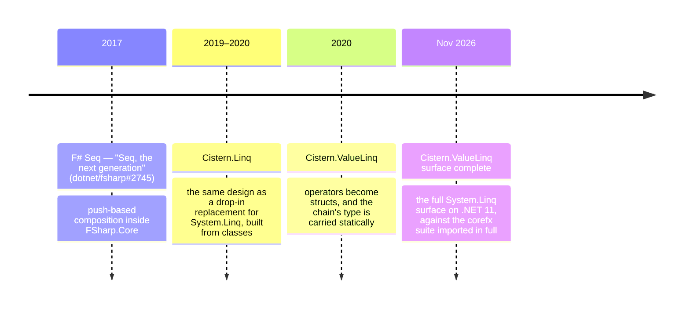

# History

[← Overview](../README.md) · [Architecture](architecture.md) · [Source generators](generators.md)

Cistern.ValueLinq is the third version of one idea: that a sequence pipeline runs faster when elements are *pushed*
through a composed chain than when each stage *pulls* from the stage before it through an enumerator.

## F# `Seq` (2017)

[dotnet/fsharp#2745](https://github.com/dotnet/fsharp/pull/2745), *Seq — the next generation*, which built on
[#2587](https://github.com/dotnet/fsharp/pull/2587), reimplemented the internals of FSharp.Core's `Seq` module. Each
operator contributed a factory to a composed pipeline, and the source folded its elements through it. Mixing these push
sequences with ordinary pull sequences carried a cost, so the composed form was kept internal. Some cases improved by
orders of magnitude (deeply nested `concat` among them) and some regressed. The change was judged too invasive for
FSharp.Core and closed in 2018.

## Cistern.Linq (2019–2020)

[Cistern.Linq](https://github.com/manofstick/Cistern.Linq) applied the design to C# as a replacement for LINQ to
Objects, aiming at full compatibility with `System.Linq` and validated against corefx's own tests. It was bootstrapped
from corefx's `System.Linq` and largely rewritten. Its operators were classes: the composed chain was built on the heap,
and its links were virtual calls.

## Cistern.ValueLinq (2020–)

The value-type version moved the chain onto the stack. Each operator became a struct generic over the struct of its
source, so that the JIT, which compiles a separate specialisation for every struct instantiation, could see and inline
the whole pipeline.

The public face of a query is a single struct, `ValueEnumerable<TSource, TNode, TEnumerator>`, which carries the
chain's type through each extension method in the manner of a monad: each operator takes a `ValueEnumerable` and
returns a `ValueEnumerable` over a larger type. The container has been here since October 2020.

Over its history the library added:

- the typed pull chain: each node's enumerator type carried alongside the node type, so `foreach` is handed the whole
  chain by value;
- request-based cross-node optimisation (`Count`, `CopyTo`, `SkipTake`, `ElementAt`, …);
- batches: spans handed down a push chain whole, so the aggregator can vectorise;
- in-place filling of the push chain, so a chain is built where it runs rather than copied into place;
- chain rebuilding: a pull chain reshaped at run time where a different shape pays (a `Skip` or `Take` merged into
  an ordering below it, a deep `Concat` flattened, an `IEnumerable<T>` source replaced by what it holds);
- Roslyn source generators writing the plumbing of each operator;
- the corefx `System.Linq` test suite, imported in full and run against Cistern.

## Related projects

Other projects have taken on the cost of LINQ to Objects in different ways. Nessos Streams built push pipelines from
F# `inline` functions, composed by the compiler at each call site. Cistern.Linq was, to the author's knowledge, the
first to bring that style of pipeline to LINQ itself. Its chains are composed at run time, from types the runtime
specialises and dispatches, so they sit behind the standard `IEnumerable<T>` operators of any .NET language rather
than being inlined into the calling code.

A project's date is its first commit, or for ZLinq the writing of its present design.

| Date | Project | Contribution |
|---|---|---|
| Aug 2013 | [LinqOptimizer](https://github.com/nessos/LinqOptimizer) | Queries compiled at run time, from expression trees, into imperative loops. |
| Jun 2014 | [Nessos Streams](https://github.com/nessos/Streams) | Push pipelines for F# (and C#), composed through F# `inline` functions, with their own API rather than LINQ's. |
| Aug 2015 | [roslyn-linq-rewrite](https://github.com/antiufo/roslyn-linq-rewrite) | Queries rewritten into loops at compile time. |
| Jan 2017 | [LinqAF](https://github.com/kevin-montrose/LinqAF) | Struct enumerables, type-inference compatible with LINQ: an operator per source and operator pairing, generated from templates. |
| Mar 2017 | [LinqFaster](https://github.com/jackmott/LinqFaster) | Eager extension methods for arrays, `List<T>` and `Span<T>`, with SIMD and parallel variants. A complement to LINQ rather than a replacement. |
| Mar 2017 | **dotnet/fsharp#2745** | Push-based composition of F#'s `Seq`. |
| Jan 2019 | [NetFabric.Hyperlinq](https://github.com/NetFabric/NetFabric.Hyperlinq) | Struct enumerables with fused operator compositions, value delegates, SIMD, and `Option<T>` results in place of exceptions. |
| Feb 2019 | [StructLinq](https://github.com/reegeek/StructLinq) | Struct enumerables through generic specialisation, struct functions in place of delegates, and `ref` access to elements. |
| Aug 2019 | **[Cistern.Linq](https://github.com/manofstick/Cistern.Linq)** | Composed push chains; a drop-in replacement for `System.Linq`. |
| Mar 2020 | [NoAlloq](https://github.com/VictorNicollet/NoAlloq) | LINQ over `Span<T>` as `ref struct`s, with buffers supplied by the caller. |
| Oct 2020 | **Cistern.ValueLinq** | Struct nodes in a `ValueEnumerable` container; push and typed pull from the same nodes. |
| Oct 2022 | [LinqGen](https://github.com/cathei/LinqGen) | A source generator emitting specialised, non-generic code per query, aimed at AOT and Unity. |
| Feb/Mar 2025 | [ZLinq](https://github.com/Cysharp/ZLinq) | A design similar to the pull side of Cistern.ValueLinq: a `ValueEnumerable` container carrying a chain of struct enumerators. Drop-in through a generator, with SIMD, and LINQ to Span and to trees. |
| Nov 2026 | **Cistern.ValueLinq** | Surface complete: the full `System.Linq` surface on .NET 11, validated against the corefx suite. |
